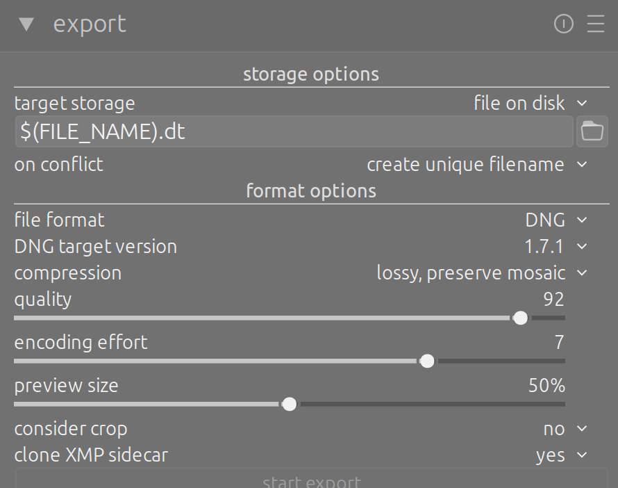

# DNG import and export in 5.6.2-dngio.2

This release extends darktable 5.6.2 with Adobe DNG SDK support for importing
and exporting DNG files. Every supported DNG export mode can be imported again
by this build, including JPEG XL (JXL) compression for both mosaic and linear
raw images.

These features require a build with `USE_DNGIO=ON`; see the
[build instructions](build.md). They are additions provided by this fork.

## Import

Import DNG files through the usual darktable import workflow. The integration
adds decoding for JPEG XL DNGs, including lossless and lossy mosaic DNGs and
linear DNGs. Mosaic DNGs retain the sensor's color filter array (CFA); linear
DNGs contain already demosaiced image data.

The Adobe SDK handles DNG decoding paths that need it, including linear DNG
processing and its associated DNG opcodes. Existing raw import paths remain
available for other supported files. The exported combinations in the table
below can all be reopened for further editing.

## Export

For scripting and batch workflows, see [command-line DNG export](#dng-export-from-the-command-line).

Select **DNG** as the file format in the export panel to convert a supported
camera raw file or transcode an existing DNG. This exports raw image data:
darkroom adjustments such as exposure, color grading, and sharpening are not
baked into the raw pixels. Use a rendered format such as JPEG or TIFF when
you want to export the edited appearance.



Example settings for DNG 1.7.1 with lossy mosaic compression. The settings
shown are an example rather than the export defaults.

### Target version and compression

The **DNG target version** controls the available compression modes:

| Compression | DNG 1.1 | DNG 1.4 | DNG 1.7.1 |
| --- | --- | --- | --- |
| Uncompressed | Yes | Yes | Yes |
| Lossless | Lossless JPEG | Lossless JPEG | Lossless JPEG XL |
| Lossy, preserve mosaic | — | — | JPEG XL |
| Lossy, linear raw | — | JPEG | JPEG XL |

Lossless compression preserves the raw samples supplied to the encoder.
Recompressing an already lossy source does not restore discarded information.
**Lossy, preserve mosaic** keeps the CFA layout; **lossy, linear raw** produces
demosaiced data. Choose a target and compression supported by the application
that will read the file.

For lossy modes, **quality** ranges from 1 to 100 (default 90). Higher values
preserve more detail and generally produce larger files. JPEG XL lossy modes
also expose **encoding effort**, from 1 to 9 (default 7); higher effort can
reduce file size at the cost of encoding time.

### Preview, crop, and editing settings

- **Preview size** embeds an SDK-rendered JPEG preview, sized from 0 to 100%
  of the visible raw image's dimensions (default 50%). Set it to 0 to omit
  previews. The preview comes from the Adobe SDK's rendering of the raw data
  and does not reproduce darktable's darkroom edits.
- **Consider crop** exports an enclosing raw rectangle corresponding to the
  current crop, mapped back into the original sensor orientation. **Extend
  crop** adds surrounding raw data toward the full image (0–99%, default 0%).
  This retains raw data rather than baking geometric transformations into it.
- **Clone XMP sidecar** writes the current darktable settings next to the
  exported file as `<filename>.dng.xmp`. With cropping enabled, the control
  becomes **partly clone XMP sidecar**: masks and geometric operations are
  reset because the raw image coordinates have changed. Both sidecar options
  are off by default.
  For lossy exports, sensor black/white settings are rescaled to the decoded
  DNG range so they do not brighten the image a second time. Sensor-level
  adjustments outside that range produce a sidecar error rather than being
  silently clipped; the exported DNG remains on disk.
- **Import to catalog** adds the exported DNG to darktable's catalog after a
  successful **file on disk** export. It is off by default. If an XMP sidecar
  is cloned, it is written before the file is imported, so darktable can read
  those settings. Other storage targets do not import their temporary files.

The default export is DNG 1.7.1 with lossless JPEG XL compression, a 50%
preview, and cropping disabled.

## DNG export from the command line

Use `darktable-cli` from a DNGIO-enabled build to convert a supported camera
raw file or transcode an existing DNG. The `.dng` output extension selects
the DNG exporter. The available settings match the
[DNG export panel](dng-export.md).

DNG export stores raw data. Exposure, color grading, and other development
settings can accompany it in an XMP sidecar; they are not baked into the raw
pixels. Lossy compression and physical cropping discard information, so keep
the original raw file if you need its complete data.

### Run the CLI

For an installed build:

```bash
darktable-cli input.ARW output.dng
```

With the local AppImage, run this from the workspace directory containing
`dist/`:

```bash
./dist/darktable-5.6.2-dngio.2-x86_64.AppImage darktable-cli input.ARW output.dng
```

If FUSE is unavailable, prefix the AppImage command with
`APPIMAGE_EXTRACT_AND_RUN=1`.

### Export a lossy mosaic DNG with cloned XMP

This example uses DNG 1.7.1, JPEG XL mosaic compression, quality 92, and a 50%
embedded preview. A separate configuration directory keeps these CLI settings
apart from the GUI configuration.

```bash
darktable-cli input.ARW output.dng --core \
  --configdir ./dngio-cli-config \
  --disable-opencl \
  --conf write_sidecar_files=never \
  --conf plugins/imageio/format/dng_jxl/target_version=2 \
  --conf plugins/imageio/format/dng_jxl/compression=2 \
  --conf plugins/imageio/format/dng_jxl/quality=92 \
  --conf plugins/imageio/format/dng_jxl/effort=7 \
  --conf plugins/imageio/format/dng_jxl/preview_size=50 \
  --conf plugins/imageio/format/dng_jxl/consider_crop=false \
  --conf plugins/imageio/format/dng_jxl/clone_xmp=true \
  --conf plugins/imageio/format/dng_jxl/import_to_catalog=false
```

The result is `output.dng` plus `output.dng.xmp`. The
`write_sidecar_files=never` setting suppresses normal input-sidecar writing;
the explicit DNG **clone XMP** option still creates the output sidecar.

To use the AppImage for this or the following examples, replace
`darktable-cli` with the AppImage invocation shown above.

### Convert a whole folder of raw files

This example runs in **Bash on Linux** with a DNGIO-enabled `darktable-cli`
installed on `PATH`. The AppImage is Linux-only. The loop can also run in Bash
on macOS with a compatible native DNGIO build; it does not run directly in
Windows PowerShell or Command Prompt.

Save the following as `convert-folder.sh`, change the two folder paths, and run
`bash convert-folder.sh`. It converts matching files directly inside the input
folder, without descending into subfolders. Extend the extension list for
other camera formats supported by your build.

```bash
#!/usr/bin/env bash
set -euo pipefail
shopt -s nullglob nocaseglob

input_dir="$HOME/Pictures/raw"
output_dir="$HOME/Pictures/dng"
config_dir="$HOME/.config/darktable-dngio-batch"
mkdir -p "$output_dir" "$config_dir"

files=("$input_dir"/*.{arw,cr2,cr3,nef,nrw,raf,orf,rw2,pef,srw,dng})
for input in "${files[@]}"; do
  [[ -f "$input" ]] || continue
  output="$output_dir/${input##*/}.dng"
  if [[ -e "$output" || -e "$output.xmp" ]]; then
    printf 'Skipping existing output: %s\n' "$output"
    continue
  fi

  printf 'Converting: %s\n' "$input"
  darktable-cli "$input" "$output" --core \
    --configdir "$config_dir" \
    --disable-opencl \
    --conf write_sidecar_files=never \
    --conf plugins/imageio/format/dng_jxl/target_version=2 \
    --conf plugins/imageio/format/dng_jxl/compression=1 \
    --conf plugins/imageio/format/dng_jxl/preview_size=50 \
    --conf plugins/imageio/format/dng_jxl/consider_crop=false \
    --conf plugins/imageio/format/dng_jxl/clone_xmp=true \
    --conf plugins/imageio/format/dng_jxl/import_to_catalog=false
done
```

The example produces lossless JPEG XL DNGs and cloned XMP sidecars. It keeps
the original extension in each output name: `photo.ARW` becomes
`photo.ARW.dng` plus `photo.ARW.dng.xmp`, avoiding collisions between sources
such as `photo.ARW` and `photo.NEF`. Filenames containing spaces work, and
extension matching ignores case. An empty input folder produces no exports.

Files are processed sequentially. The script stops if a conversion fails;
inspect any partial output before rerunning, because existing outputs are
skipped. Keep the output folder separate from the input folder when processing
DNG sources. To use the Linux AppImage, replace `darktable-cli` in the loop
with its absolute path followed by `darktable-cli`, as shown above.

### DNG settings

Pass each setting as `--conf plugins/imageio/format/dng_jxl/<setting>=<value>`
after `--core`.

| Setting | Values | Default |
| --- | --- | --- |
| `target_version` | `0`: DNG 1.1; `1`: DNG 1.4; `2`: DNG 1.7.1 | `2` |
| `compression` | `0`: uncompressed; `1`: lossless; `2`: lossy mosaic; `3`: lossy linear raw | `1` |
| `quality` | `1–100`, for lossy compression | `90` |
| `effort` | `1–9`, exposed for lossy JPEG XL encoding | `7` |
| `preview_size` | `0–100` percent; `0` omits embedded previews | `50` |
| `consider_crop` | `true` or `false` | `false` |
| `crop_extension` | `0–99` percent, when cropping | `0` |
| `clone_xmp` | `true` or `false` | `false` |
| `import_to_catalog` | `true` or `false`, for disk exports | `false` |

These are fresh-configuration defaults; saved settings can differ. Set the
values explicitly when scripting repeatable exports.

Lossy mosaic requires target `2`. Lossy linear raw requires target `1` or `2`.
Lossless target `2` uses JPEG XL; older targets use lossless JPEG. Unsupported
target/compression combinations fail. See the
[compatibility table](#target-version-and-compression).

### Apply a crop from an XMP sidecar

Place the source XMP between the input and output filenames:

```bash
darktable-cli input.ARW input.ARW.xmp cropped.dng --core \
  --configdir ./dngio-cli-config \
  --conf write_sidecar_files=never \
  --conf plugins/imageio/format/dng_jxl/target_version=2 \
  --conf plugins/imageio/format/dng_jxl/compression=1 \
  --conf plugins/imageio/format/dng_jxl/consider_crop=true \
  --conf plugins/imageio/format/dng_jxl/crop_extension=0 \
  --conf plugins/imageio/format/dng_jxl/clone_xmp=true \
  --conf plugins/imageio/format/dng_jxl/import_to_catalog=false
```

This stores an enclosing sensor-aligned rectangle for the current crop. The
cloned sidecar resets geometric operations and masks for the new coordinates
while retaining sensor normalization. Rotation and perspective correction
are not rendered into the mosaic. See [crop behavior](dng-export.md#consider-crop).

### Add the export to a persistent catalog

The CLI normally uses an in-memory catalog, which disappears when it exits.
Supply `--library` before `--core` to retain imported files:

```bash
darktable-cli input.ARW catalog-output.dng \
  --library ./dngio-catalog.db --core \
  --configdir ./dngio-cli-config \
  --conf write_sidecar_files=never \
  --conf plugins/imageio/format/dng_jxl/target_version=2 \
  --conf plugins/imageio/format/dng_jxl/compression=1 \
  --conf plugins/imageio/format/dng_jxl/consider_crop=false \
  --conf plugins/imageio/format/dng_jxl/clone_xmp=true \
  --conf plugins/imageio/format/dng_jxl/import_to_catalog=true
```

The CLI registers its input and the successfully exported DNG in that catalog.
Import reads the cloned sidecar after it has been written. With `--library`,
development settings come from the catalog rather than a separately supplied
source XMP. Close any GUI instance using the same catalog before running the
CLI against it; the example uses a dedicated CLI catalog.

## Scope and verification

Existing DNGs are transcoded directly when **consider crop** is disabled.
Conversion from other camera raw formats, and the crop path, require
single-channel 16-bit Bayer or X-Trans raw data. Rendered RGB inputs such as
JPEG and TIFF are not supported by this raw DNG exporter.

The [test suite](../../tests/dngio/README.md) checks import, re-import of all
nine target/compression combinations, lossless raw-sample round trips,
camera raw conversion, previews, cropping, and XMP sidecars. X-Trans export
is implemented but does not yet have a regression fixture in this suite.

See [licensing and third-party notices](../../LICENSING.md) for the bundled
Adobe SDK and other dependencies.
